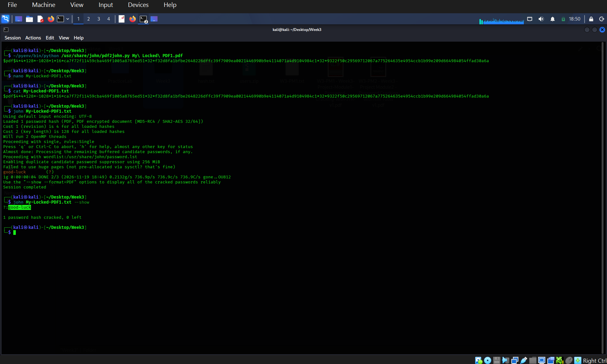

# Week 03: Password Security Assessment

**Program:** Networkwalks Cybersecurity Training  
**Batch:** B084  
**Week:** 03  
**Focus Area:** Password Security and Assessment  
**Operating System:** Kali Linux

## 1. Introduction

During Week 03 of the Networkwalks Cybersecurity Training Program, I explored password security and learned how password protection can be evaluated through controlled laboratory exercises.

The practical sessions focused on understanding password hashes, dictionary-based assessment techniques, and the importance of using strong and unpredictable passwords.

This exercise provided an opportunity to gain hands-on experience with security tools available in Kali Linux and browser-based security utilities.

## 2. Objectives

The main objectives of these practical exercises were to:

- Understand how password hashes are extracted and used during security assessments.
- Gain practical experience with John the Ripper.
- Understand the role of `pdf2john` in preparing PDF password hashes for assessment.
- Explore dictionary-based password testing.
- Understand the importance of strong password practices.

## 3. Tools and Technologies Used

| Tool | Purpose |
|---|---|
| Kali Linux | Security testing environment |
| John the Ripper (JTR) | Password security assessment |
| pdf2john | Extracting password hash information from PDF files |
| RockYou Wordlist | Dictionary-based password testing |
| Networkwalks Hash Calculator | Browser-based hash exploration |
| Networkwalks Password Cracker | Browser-based password assessment |

## 4. Practical Exercises

### Exercise 1: PDF Password Security Assessment Using John the Ripper

The first exercise involved assessing the password protection of a sample PDF document using John the Ripper.

The process involved:

1. Preparing the sample PDF file for assessment.
2. Using `pdf2john` to extract the password hash information.
3. Passing the extracted hash information to John the Ripper.
4. Performing a dictionary-based assessment using the RockYou wordlist.
5. Observing and analysing the results.

**Evidence 1:** Screenshot showing the John the Ripper assessment and terminal output.

### Exercise 2: Browser-Based Password Assessment

The second exercise involved exploring Networkwalks' browser-based Hash Calculator and Password Cracker tools.

This provided an opportunity to understand password assessment through a web-based interface.

The exercise focused on:

- Exploring hash calculation functionality.
- Understanding dictionary-based password testing.
- Observing how password strength affects the assessment results.

**Evidence 2:** Screenshot showing the Networkwalks Hash Calculator interface.

## 5. Key Technical Concepts Learned

### Password Hashing

Password hashing involves converting passwords into fixed-length representations using hashing algorithms. Systems commonly store password hashes instead of plaintext passwords.

### Dictionary-Based Assessment

Dictionary-based assessment involves testing passwords against a prepared collection of commonly used words and password combinations.

The exercise demonstrated why predictable passwords can be vulnerable to guessing attempts.

### Password Strength

Strong passwords should be:

- Long and sufficiently complex.
- Unique to each account.
- Difficult to predict.
- Stored using a reputable password manager where appropriate.

Multi-factor authentication (MFA) also provides an additional layer of account protection.

## 6. Challenges and Observations

One important observation from the exercises was how quickly predictable passwords could be identified when they appeared in a dictionary wordlist.

This demonstrated that password security should not rely on secrecy alone. Password length, uniqueness, unpredictability, and secure storage all matter.

## 7. Key Takeaways

This week's practical exercises strengthened my understanding of password security and introduced me to tools used in controlled password assessments.

My major takeaways were:

1. Password hashes are important components of authentication security.
2. Weak and predictable passwords can be exposed through dictionary-based testing.
3. Password strength plays an important role in protecting digital information.
4. Security tools are useful for identifying weaknesses and understanding defensive measures.

## 8. Conclusion

Week 03 was an important step in developing my practical cybersecurity knowledge.

Working with John the Ripper, pdf2john, and Networkwalks' browser-based tools helped me understand password assessment techniques and the importance of implementing stronger authentication practices.

I look forward to building on these skills as I continue developing my cybersecurity knowledge.

## 9. Acknowledgements

Special thanks to **Networkwalks** and **Waqas Karim (CCIE)** for providing the training resources, practical exercises, and guidance throughout the program.

---

**Disclaimer:** All activities documented in this report were intended for educational purposes and controlled laboratory exercises using sample materials. No unauthorised systems or accounts were targeted.
